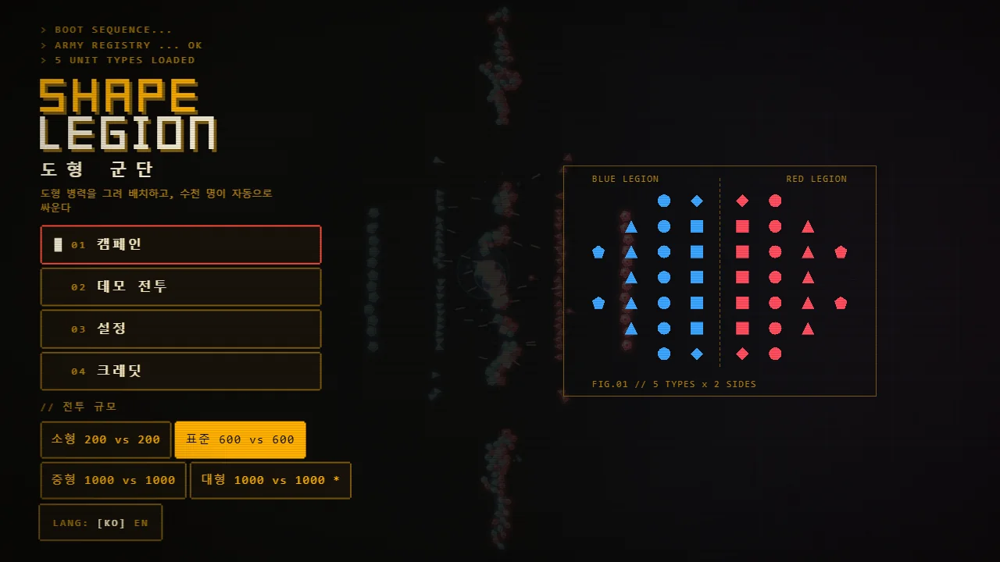
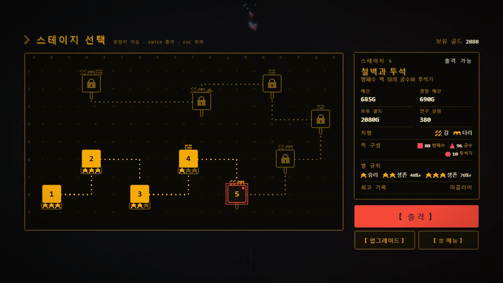
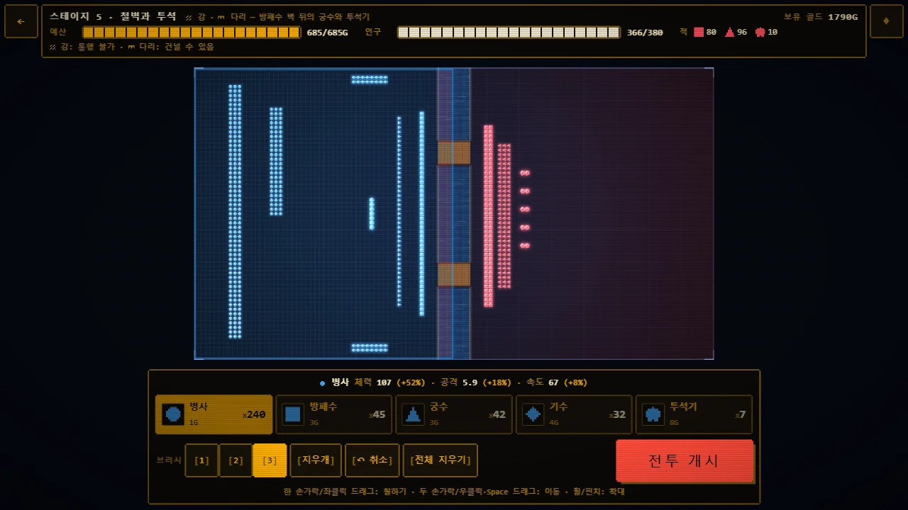
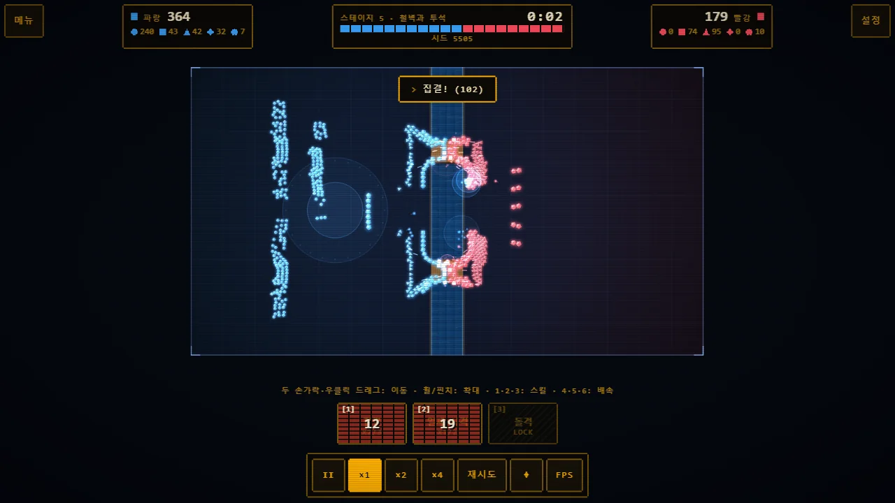
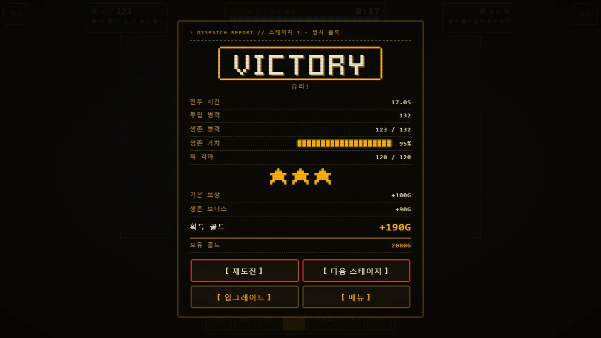
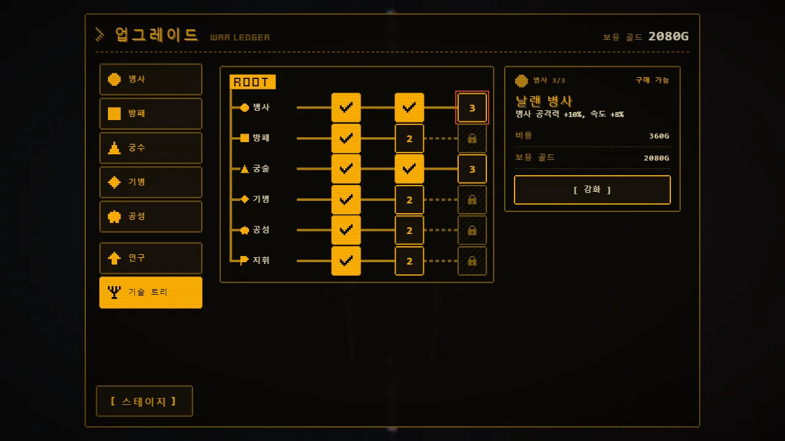

<h1 align="center">Shape Legion — 도형 군단</h1>

<p align="center">
  도형 병력을 그려 배치하고, 수천 명이 자동으로 싸우는 <b>웹 전략 자동전투 게임</b><br>
  바닐라 JavaScript(ES 모듈) + Canvas 2D · 빌드 도구 없이 정적 파일만으로 동작 · 한국어 / English
</p>

<p align="center">
  <a href="https://sigco3111.github.io/shape-legion/"><b>▶ 지금 플레이: https://sigco3111.github.io/shape-legion/</b></a>
</p>

## 스크린샷

<table>
  <tr>
    <td width="50%"><br><sub><b>시작 화면</b> — 부팅 문구 3줄이 끝난 뒤의 세로 메뉴(캠페인 · 데모 전투 · 설정 · 크레딧), 전투 규모 버튼, 오른쪽의 파랑/빨강 5종 진형 도식. 뒤쪽에서 데모 전투가 돌아갑니다.</sub></td>
    <td width="50%"><br><sub><b>스테이지 선택</b> — 작전 지도 위의 노드 10개. 1~4는 클리어(별 표시), 5는 선택된 출격 가능 노드, 6~10은 잠김. 오른쪽에 예산·권장 예산·적 구성·별 규칙이 있는 브리핑 패널.</sub></td>
  </tr>
  <tr>
    <td><br><sub><b>배치 단계 (스테이지 5)</b> — 강과 다리 2개. 파란 구역에 병사·방패수·궁수·기수·투석기를 칠해 예산 685/685G, 인구 366/380을 채운 모습. 오른쪽은 미리 놓인 빨간 적 진형, 아래는 유닛·브러시 패널.</sub></td>
    <td><br><sub><b>전투</b> — 아군 364 대 적 179로 시작한 직후, 다리 앞에서 맞붙는 유닛들. 집결 · 일제 사격 효과 링과 토스트, 아래 스킬 플레이트(쿨다운 표시)와 배속 버튼.</sub></td>
  </tr>
  <tr>
    <td><br><sub><b>결과 화면</b> — 스테이지 1 VICTORY. 전투 시간 · 투입/생존 병력 · 생존 가치 막대 · 적 격파, 별 3개, 기본 보상 +100G와 생존 보너스 +90G, 버튼 4개.</sub></td>
    <td><br><sub><b>업그레이드 '전쟁 장부'</b> — 왼쪽 병종 탭(병사 · 방패 · 궁수 · 기병 · 공성 · 인구 · 기술 트리), 가운데 6갈래 기술 트리 도식, 오른쪽 선택한 노드의 상세와 [ 강화 ] 버튼.</sub></td>
  </tr>
</table>

<sub>스크린샷은 1280×720 화면의 실제 사이트에서, 진행 상황이 일부 채워진 테스트용 저장 데이터로 찍었습니다.</sub>

## 특징

- **스테이지 10개** — 난이도 곡선과 권장 예산이 있고, 4번부터 **강 · 다리 · 돌벽 · 언덕** 지형이 나옵니다.
- **유닛 5종** — 병사(원) · 방패수(사각) · 궁수(삼각) · 기수(마름모) · 투석기(오각)와 가위바위보식 상성.
- **칠해서 배치** — 손가락/마우스로 진형을 그립니다. 브러시 1/2/3(기술 트리로 4), 지우개, 실행 취소(획 단위), 전체 지우기. 골드 예산과 인구 상한이 실시간으로 표시됩니다.
- **지휘관 스킬 3종** — 집결 · 일제 사격 · 돌격 (키 `1` `2` `3`).
- **업그레이드와 기술 트리** — 골드로 인구 상한, 유닛별 체력/공격력/속도·사거리, 병사·방패·궁술·기병·공성·지휘 **6갈래 기술 트리**를 구매합니다.
- **소리** — 효과음 16개 + 메뉴/전투 BGM(WebAudio). 전체/효과음/음악 음량과 음소거는 저장됩니다.
- **레트로 픽셀 CRT UI** — 호박색 터미널 스타일. 설정의 **CRT 효과 끄기 / 약하게 / 보통**으로 조절합니다.
- **한국어 / English**, **터치 지원**(한 손가락 칠하기, 두 손가락 이동·핀치 확대, 44px 이상 버튼).
- **자동 적응 유닛 상한** — 설정에서 자동/500/1000/2000/3000. 자동은 프레임이 낮으면 효과 → 블룸 → 상한 순으로 낮춥니다(최대 약 3000).
- 같은 시드로 전투가 재현되고(`?seed=N`), 별 · 골드 · 해금 · 업그레이드는 브라우저(localStorage)에 저장됩니다.

## 유닛과 상성

비용은 골드. 표의 숫자는 **공격자(행) → 방어자(열)** 피해 배율입니다(`js/units.js`의 `MULT`).

| 공격 \ 방어 | 병사 | 방패수 | 궁수 | 기수 | 투석기 | 비용 · 특징 |
|---|---|---|---|---|---|---|
| **병사** (원) | 1.0 | 0.9 | 1.2 | 1.0 | 1.3 | 1G · 균형형 근접, 저렴한 물량 |
| **방패수** (사각) | 1.0 | 1.0 | 1.2 | 1.0 | 1.3 | 3G · 느리고 단단함(방어 0.4), 기수 돌격 피해 감소 |
| **궁수** (삼각) | 1.0 | **1.7** | 1.0 | 0.7 | 1.1 | 3G · 원거리, 방패수를 꿰뚫음, 연약 |
| **기수** (마름모) | 1.0 | 0.6 | **1.8** | 1.0 | 1.3 | 4G · 빠름, 첫 타격 돌격 보너스 |
| **투석기** (오각) | **1.5** | 1.0 | 1.0 | 0.9 | 1.0 | 8G · 초장거리 범위 피해, 가까운 적에는 무력 |

## 지휘관 스킬

적은 스킬을 쓰지 않습니다. 대상이 하나도 없으면 횟수와 쿨다운이 소모되지 않고, 쿨다운은 시뮬레이션 시간 기준이라 일시정지하면 멈춥니다.

| 키 | 스킬 | 효과 | 횟수 / 쿨다운 | 해금 |
|---|---|---|---|---|
| `1` | **집결** | 커서(터치는 버튼 후 탭한 지점) 반경 안의 아군이 그 지점으로 모이며 4초간 속도 +20% | 3회 / 12초 | 처음부터 |
| `2` | **일제 사격** | 사거리 안의 아군 궁수·투석기가 즉시 +50% 피해로 한 번 더 발사 | 2회 / 20초 | 기술 트리 '지휘' 1단계 |
| `3` | **돌격** | 아군 기수 5초간 속도 +60%, 피해 +40% | 2회 / 25초 | 기술 트리 '지휘' 2단계 |

## 지형 (스테이지 4~10)

- **강**: 건널 수 없는 띠. 투사체는 통과하므로 궁수·투석기는 강 너머로 쏠 수 있습니다. **다리**가 유일한 통로라 병목이 됩니다.
- **돌벽**: 지나갈 수 없고 **화살을 막습니다**(투석기의 포물선 투석은 벽을 넘음). 틈(문)이 통로입니다.
- **언덕**: 지나갈 수 있고, 그 위의 궁수·투석기는 사거리 +25%(양 팀 공통).
- 물·벽 칸에는 칠할 수 없고(빨간 칸), 적 진형도 지형을 피합니다.
- 4 넓은 원진(벽) · 5 철벽과 투석(강+다리 2) · 6 혼성 기병대(강+다리 3) · 7 투석 포대(성벽과 문) · 8 군단장(돌기둥) · 9 두 다리와 궁수 언덕 · 10 최후의 강(강+다리 3+다리 어귀 벽).

## 플레이 방법

1. 시작 화면에서 **캠페인** → 스테이지 선택. 잠긴 스테이지는 이전 스테이지를 클리어해야 열립니다. 예산이 권장치의 85% 미만이면 '예산 부족 주의'가 붙습니다.
2. **배치 단계**: 왼쪽 파란 구역에 유닛을 칠합니다. 오른쪽 빨간 구역은 미리 놓인 적 진형입니다.
3. **전투 개시**: 자동전투가 시작됩니다. 일시정지, ×1/×2/×4 배속, 지휘관 스킬을 쓸 수 있습니다.
4. **결과**: 승리하면 별 1개, 생존 가치가 배치 비용의 40% 이상이면 2개, 70% 이상이면 3개. 골드는 승리 시 기본 + 생존 보너스, 패배해도 위로금을 받습니다.
5. **업그레이드**: 스테이지 선택·결과 화면의 [ 업그레이드 ]에서 골드를 씁니다. 쓰러진 유닛은 다음 전투에 모두 복귀합니다(영구 손실 없음).

시작 화면의 **데모 전투**(소형 200 · 표준 600 · 중형 1000 · 대형 1500, 각 진영 기준이며 유닛 상한을 넘으면 비율대로 줄어듭니다)는 배치 없이 바로 대규모 전투를 구경하는 모드입니다.

## 조작

| 입력 | 동작 |
|---|---|
| 드래그 (마우스 좌클릭 / 한 손가락) | 배치 단계: 칠하기 · 전투/데모: 화면 이동 |
| 두 손가락 / 우클릭 드래그 / `Space` + 드래그 | 화면 이동 (배치 단계 포함) |
| 휠 / 두 손가락 핀치 | 확대·축소 |
| 더블클릭 · `F` · ⌖ | 화면 맞춤 |
| `↑` `↓` · `Enter` | 시작 메뉴 이동 · 선택 |
| `←` `→` `↑` `↓` · `Enter` · `Esc` | 스테이지 지도: 이동 · 출격 · 뒤로 (노드를 한 번 더 탭해도 출격) |
| `Space` | 전투 일시정지 |
| `1` `2` `3` | 캠페인: 스킬 · 데모: 배속 ×1/×2/×4 |
| `4` `5` `6` | 캠페인: 배속 ×1/×2/×4 |
| `R` | 같은 시드로 다시 (NEW 버튼 = 새 전투) |
| `+` `-` · 방향키 (전투 중) | 확대 / 이동 |
| `Esc` | 열린 창 닫기 · 결과/업그레이드에서 뒤로 · 집결 지점 지정 취소 |

URL 옵션: `?seed=N` · `?cap=500|1000|2000|3000` · `?noadapt=1` · `?debug=1`(통계 패널) · `?lang=ko|en` · `?selftest=1[&full=1]`

## 작동 방식

- **바닐라 JS ES 모듈** — 번들러·프레임워크 없음. 시뮬레이션(`js/sim.js`)은 DOM이 없어 브라우저와 Node에서 똑같이 돌아갑니다.
- **타입드 배열 시뮬레이션** — SoA(Float32/Uint8/Int32) 풀, 고정 30Hz 틱, 렌더는 이전/현재 위치를 보간해 60fps.
- **공간 해시** — 분리용 전체 격자와 팀별 목표 탐색 격자를 매 틱 카운팅 정렬로 재구성합니다.
- **흐름 지도(flow-field) 경로** — 직선이 지형에 막히면 전투 시작 때 한 번 계산한 거친 격자(25px) 거리 지도를 따라 다리·문으로 향합니다.
- **Canvas 2D 스프라이트 아틀라스** — 팀 × 종류 × 피격 플래시 × 16방향을 줌 구간별로 미리 그려 `drawImage`로 배치하고, 뷰포트 컬링과 저해상도 블룸 패스를 씁니다.
- **WebAudio** — 첫 제스처에서 시작, 디코드 버퍼 캐시, 동시 음성 상한, 종류별 최소 간격, 이벤트 집계, 메뉴 ↔ 전투 BGM 페이드. 파일을 못 불러오면 조용히 넘어갑니다.
- **결정론** — `mulberry32` 시드 하나로 전투 전체가 재현됩니다.
- 자세한 설계와 라운드별 체크리스트는 [docs/DESIGN.md](docs/DESIGN.md).

## 로컬 실행

빌드가 필요 없습니다. 아무 정적 서버로 폴더를 열면 됩니다.

```bash
python3 -m http.server   # → http://localhost:8000
```

### 자체 테스트

| 명령 | 내용 |
|---|---|
| 브라우저 `?selftest=1` (`&full=1` 확장) | 600v600 혼성 승률/전투 시간, 5×5 상성표, 1000v1000 틱당 시뮬 ms |
| `node js/selftest.js [full]` | 위와 같은 테스트를 Node(20+)에서 실행 |
| `node js/terraintest.js [시드 수]` | 지형 안 유닛 0 · 다리 하나짜리 강 전투 종료 시간 · 벽의 화살 차단 · 평지 vs 강 틱당 ms |
| `node js/stagetest.js [시드 수] [스테이지\|all]` | 스테이지별 예상 업그레이드 수준에서 자동 배치 승률 · 병사 덩어리 승률 · 최대 전투 시간 (`... 1 1 skills`로 스킬 효과 확인) |
| `node js/audiotest.js` | 모의 AudioContext로 음성 상한·간격 제한·파일 존재 확인 |

캐시 무효화: `index.html`과 모든 `js` import의 `?v=<번호>`를 함께 올립니다(CSS 링크는 따로 올려도 됩니다).

## 프로젝트 구조

`index.html` · `css/style.css` · `js/` (`main` 루프/설정/캠페인 흐름 · `stages` 스테이지·별·저장 · `upgrades` 업그레이드·기술 트리 · `deploy` 칠하기 · `skills` 지휘관 스킬 · `terrain` 지형 · `units` 수치 표 · `sim` 시뮬레이션 · `formation` 진형 · `render` 렌더러 · `ui` DOM · `i18n` · `icons` 픽셀 아이콘 · `audio` · `rng` · `selftest` · `terraintest` · `stagetest` · `audiotest`) · `assets/` (OGG 18개, 글꼴, 아이콘) · `docs/` · `CREDITS.md` · `LICENSE`

## 크레딧 / 라이선스

- **코드**: MIT 라이선스 — Copyright (c) 2026 sigco3111 ([LICENSE](LICENSE)).
- **도형 · 이펙트**는 코드(Canvas 2D)로 그렸고, **소리 · 글꼴**은 아래 에셋입니다(소리는 OGG로 변환하고 길이를 잘랐습니다). 모두 [game-asset-catalog](https://github.com/sigco3111/game-asset-catalog)에서 받았습니다.
- **CC-BY 표기**: dklon — "Boom Pack 2" (https://opengameart.org/content/boom-pack-2), **CC-BY 3.0** (https://creativecommons.org/licenses/by/3.0/). `boulder_boom`에 사용, OGG로 변환하고 길이를 잘랐습니다.
- 나머지는 모두 **CC0 1.0**: Kenney(Impact Sounds · Interface Sounds · Music Jingles · Kenney Fonts의 Pixel Square 글꼴), BMacZero(Metal Impact Sounds), Almitory(Fantasy Magic Spell), Tozan(Rpg Loop 1), Snabisch(Calm Ambient 3).

파일별 상세는 [CREDITS.md](CREDITS.md)와 게임 안의 **크레딧** 화면에 같은 내용으로 적혀 있습니다.

## 알려진 한계

- 성능은 기기에 따라 다릅니다. 프레임이 낮으면 이펙트와 유닛 상한이 자동으로 줄어듭니다.
- 소리는 청취 테스트 없이 골랐습니다. 어색한 소리는 `assets/audio/`의 파일을 바꾸면 됩니다.
- 1인 플레이 전용입니다. 적은 스킬을 쓰지 않으며, 사기/패주는 아직 없습니다.
- 진행 상황은 브라우저 localStorage에만 저장됩니다(기기 간 동기화 없음).
